# DEX

[](LICENSE)
[](https://github.com/Chethan616/Dex/releases/latest)
[](https://github.com/Chethan616/Dex/releases)
[](https://github.com/Chethan616/Dex/stargazers)
[](CONTRIBUTING.md)
[](https://github.com/Chethan616/Dex/labels/good%20first%20issue)

**An open-source AI agent that does real work on your Windows PC — in your browser, your files, your apps and your accounts — while you keep using it. Hand it tasks from your desk, your phone, WhatsApp or Telegram.**

<p align="center">
  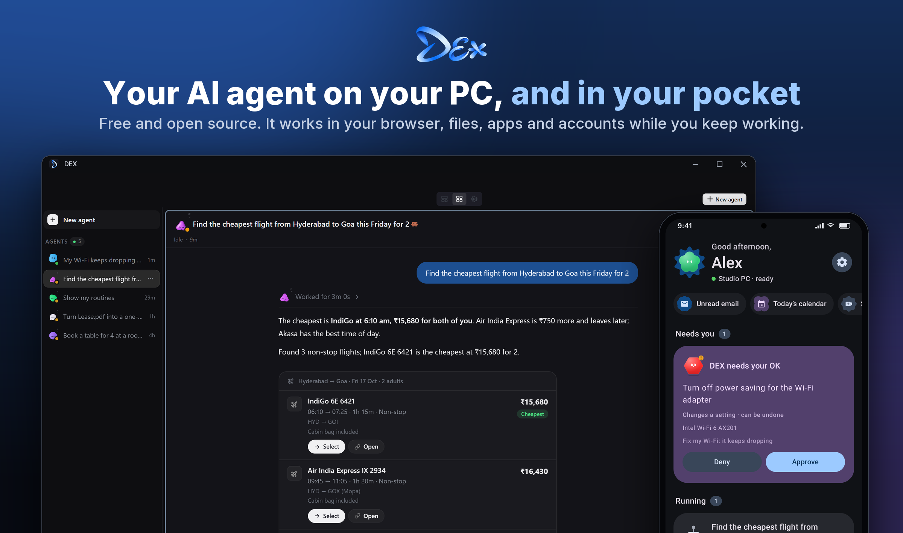
</p>

Tell DEX what you want in plain words:

> *"Find the cheapest flight from Hyderabad to Goa this Friday for 2."*
> *"Reply to the mail from my landlord and put the inspection in my calendar."*
> *"My Wi-Fi keeps dropping. Find out why and fix it."*
> *"Turn this PDF into a one-page summary and send it to my phone."*

DEX plans it, does it on your PC, shows you every step live, and asks before
anything risky. Answers come back as things you can act on — flight cards with
**Select** and **Open**, a date picker when it needs a date — not walls of text.

**[⬇ Download for Windows](https://github.com/Chethan616/Dex/releases/latest)** · **[Android app](https://github.com/Chethan616/Dex/releases/latest)** · free and open source (Apache-2.0)

## See it

<p align="center">
  <a href="https://github.com/Chethan616/Dex/releases/download/v2.1.1/DEX-demo.mp4">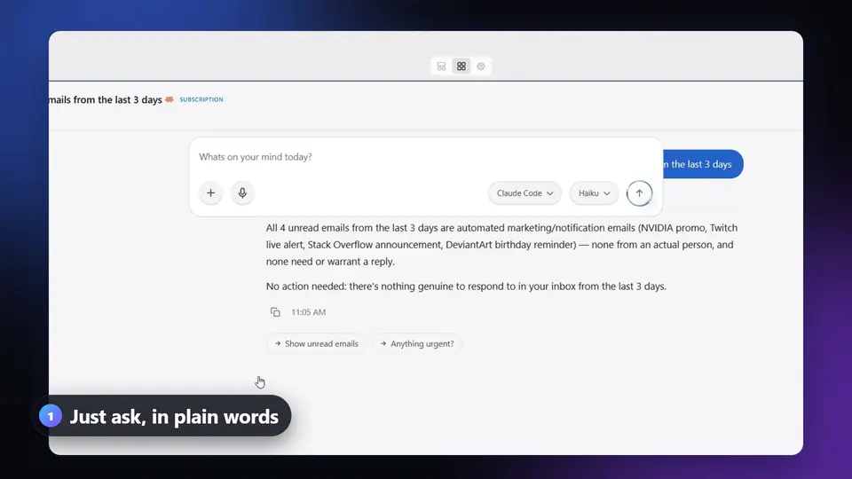</a>
  <br><sub><b><a href="https://github.com/Chethan616/Dex/releases/download/v2.1.1/DEX-demo.mp4">▶ Watch the 76-second demo</a></b></sub>
</p>

<table>
  <tr>
    <td width="50%">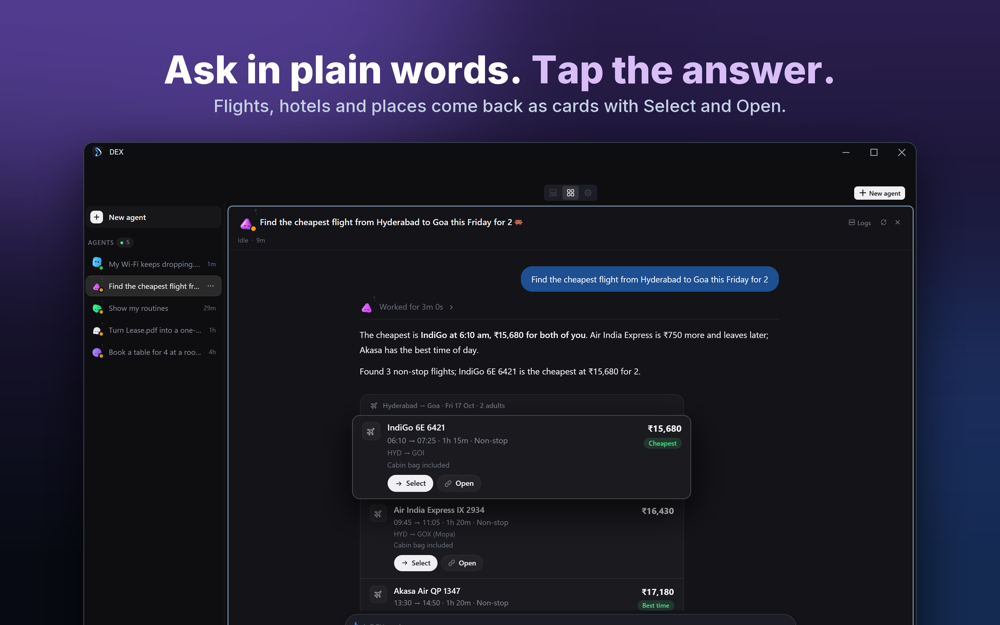</td>
    <td width="50%">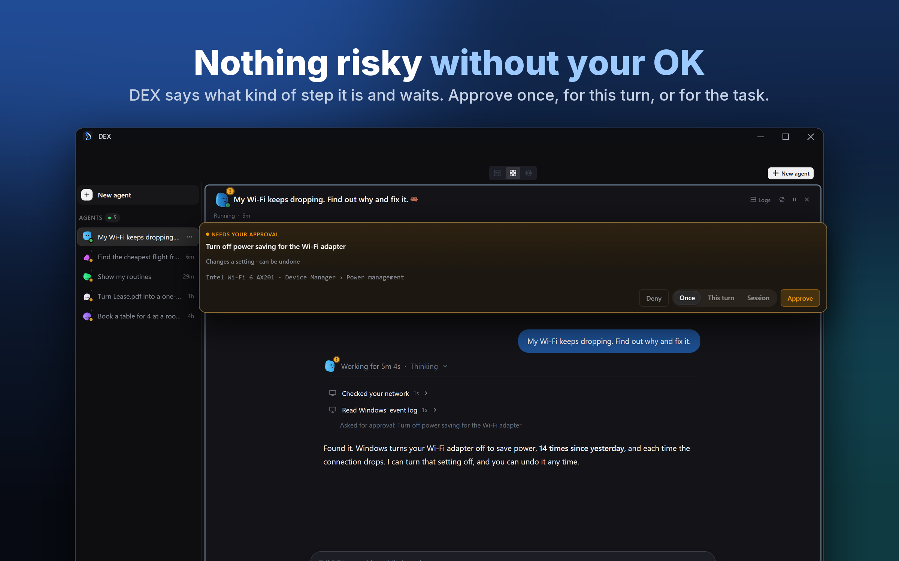</td>
  </tr>
  <tr>
    <td width="50%">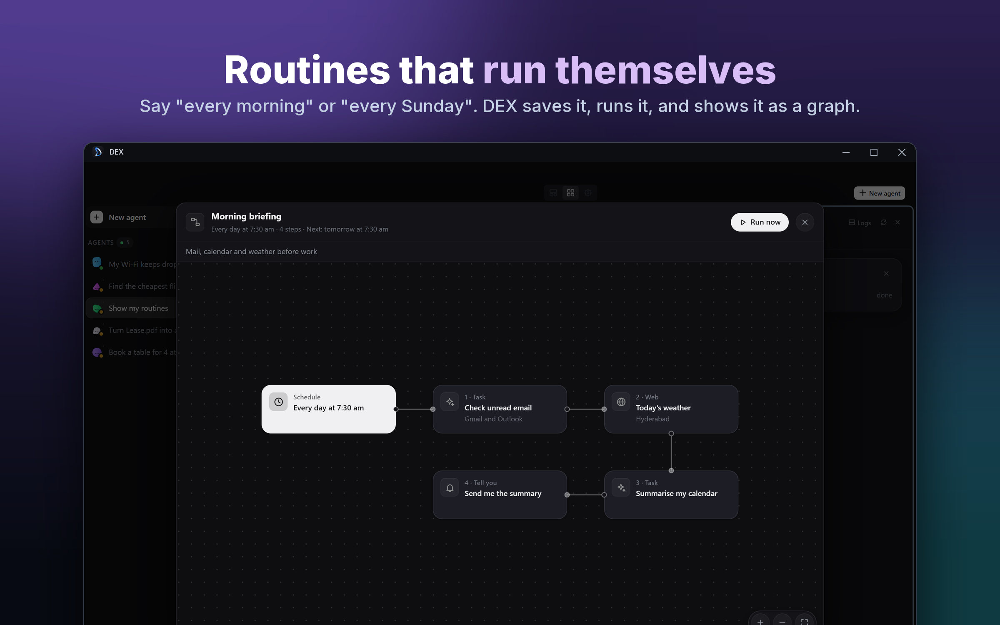</td>
    <td width="50%">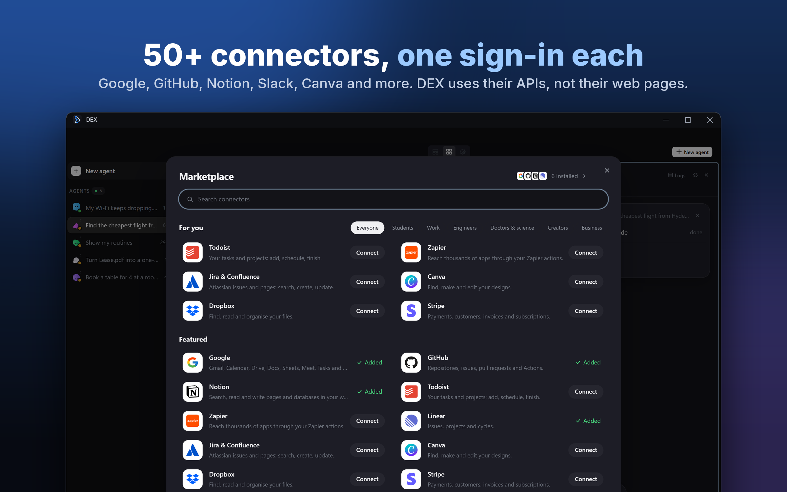</td>
  </tr>
  <tr>
    <td colspan="2">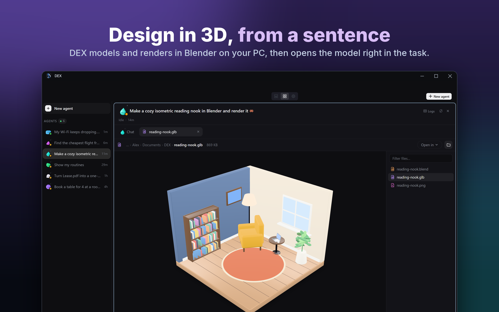</td>
  </tr>
</table>

### Made by DEX, in 3D

> *"In Blender, build a 3D scene of a Japanese shrine in a misty forest: a red torii gate, stone lanterns, a small wooden shrine and cherry blossom trees. Light it beautifully, render it, and show me the render and the 3D model."*

<p align="center">
  
</p>

<table>
  <tr>
    <td width="50%"></td>
    <td width="50%"></td>
  </tr>
  <tr>
    <td width="50%"></td>
    <td width="50%"></td>
  </tr>
</table>

One sentence, one task. DEX (Claude Code on Opus) planned the shot, modelled
the torii, the lanterns and the shrine, placed and recoloured Poly Haven trees
into cherry blossom, added the mist and the morning light, checked its own
renders along the way and rendered the final frame in Cycles, all in DEX's
background Blender while the PC stayed free. The views above are the same
`.blend` from other angles.

**[▶ Watch the demo](https://github.com/Chethan616/Dex/releases/download/v2.1.1/DEX-demo.mp4)**: browsing, Notepad, the inbox card and this scene, in 76 seconds.

**On your phone** ([DEX for Android](https://github.com/Chethan616/Dex/releases/latest)):

<p align="center">
  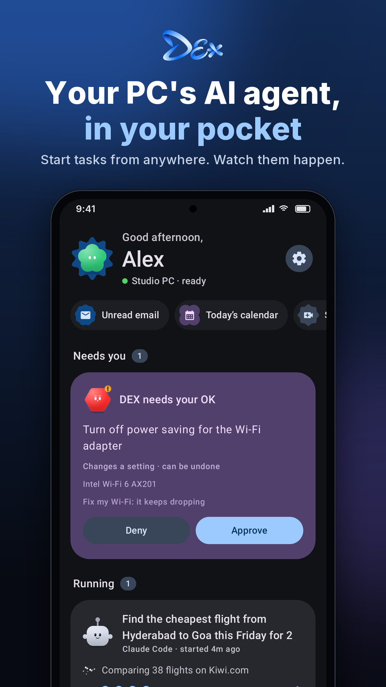
  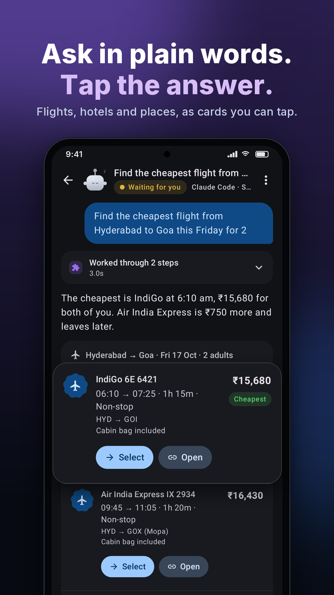
  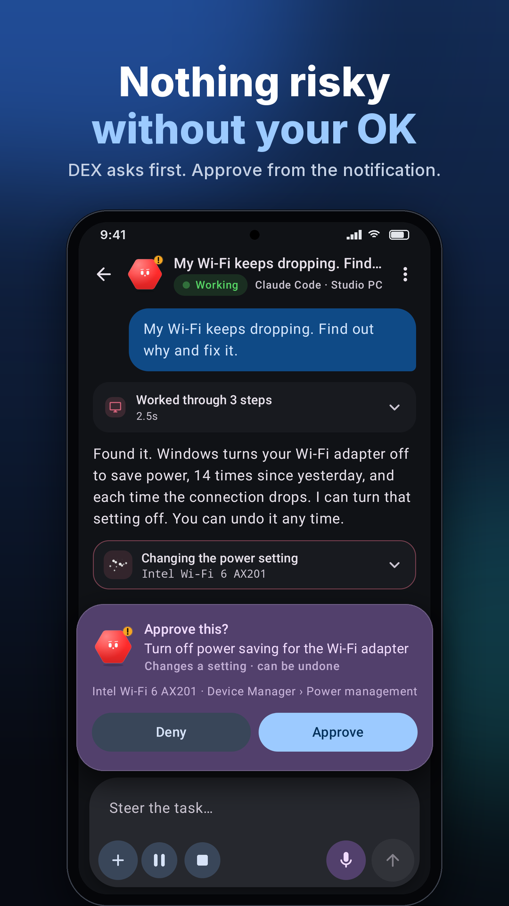
  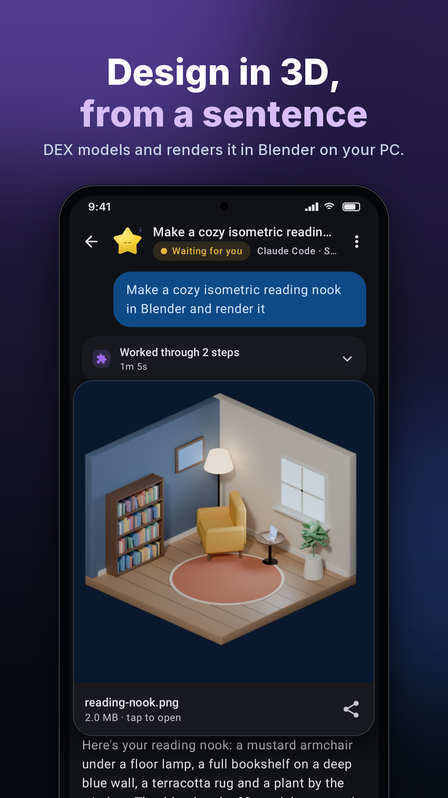
  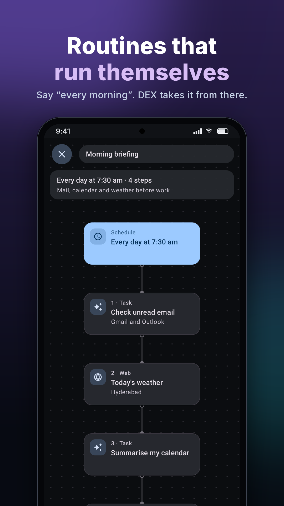
  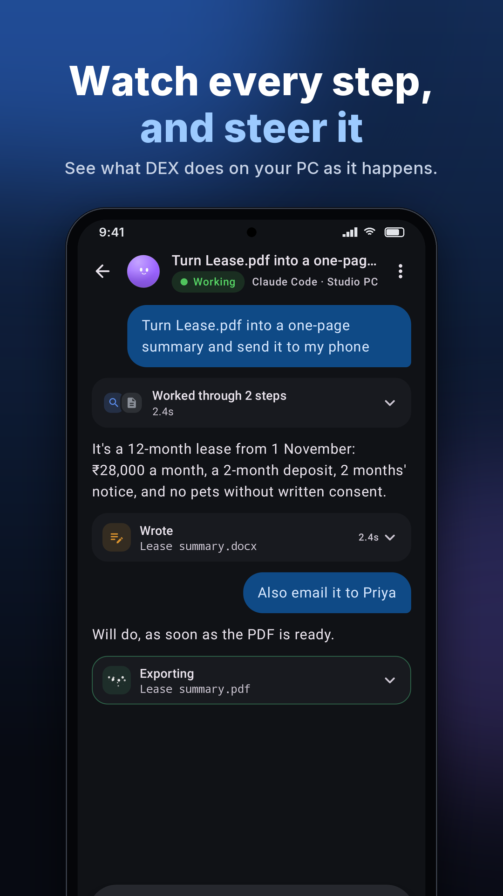
</p>

## What DEX can do

- **Use the web like you do.** Each task gets its own workspace: real browser
  tabs that you and DEX share (you can click around while it works), the
  documents it makes, and a chat. A small *DEX* cursor shows where it clicks.
- **Work your accounts properly.** 50+ connectors — Google (Gmail, Calendar,
  Drive, Docs, Sheets, Meet), GitHub, Notion, Jira, Linear,
  Slack, Canva, Dropbox, Stripe, PubMed and more — each one a single sign-in in
  your browser. DEX uses the service's API instead of clicking through its
  website: faster, cheaper and it doesn't break when a page changes.
- **Travel without the tab chaos.** Flights come from Kiwi.com and hotels from
  trivago, straight into cards you can tap — no sign-in, nothing to set up.
- **Drive Windows itself.** DEX works your apps and settings in the
  background without taking your mouse: play music, check what's wrong with
  the Wi-Fi, fix it (with undo). If it ever has to borrow your mouse, it lets
  go the moment you move.
- **Run routines.** Say "every morning" or "every Sunday" and DEX saves it as
  a routine, runs it on its schedule, and shows it as a step-by-step graph.
  Type `/workflow` to see them all.
- **Make and open files.** PDFs, Word, Excel, CSV, Markdown, code, images,
  video and 3D models open right inside the task, and reload as DEX edits them.
  It can even build 3D scenes in Blender.
- **Reach it from anywhere.**
  - **Phone app (Android):** start tasks, follow them live in a status-bar
    live update, approve steps and open the files it made.
  - **WhatsApp:** text yourself `@DEX book a table for 4 tonight`.
  - **Telegram:** your own private DEX bot, set up in a minute.

## Why DEX

- **It runs on your PC,** with your logins and your files. There's no cloud
  browser and no one else's computer in the middle.
- **Bring your own brain.** Sign in to **Claude Code** or **Codex** with the plan
  you already have, or use **BrowserCode** with your own key for Kimi, Qwen
  or MiniMax.
- **You stay in control.** Choose how much it may do on its own: *Ask for
  approval*, *Approve for me* (routine steps run, risky ones ask) or *Full
  access*. Password fields are masked from the agent, tokens live in the
  Windows Credential Manager, and it never touches your password manager,
  Windows Security or terminals. See [SECURITY.md](SECURITY.md).
- **Open source,** under Apache-2.0. Read it, change it, ship it.

## Get started

1. **Download [`dex-setup.exe`](https://github.com/Chethan616/Dex/releases/latest)** and run it (Windows 10 or 11).
   It isn't code-signed yet, so SmartScreen may say *"Windows protected your PC"*: click **More info → Run anyway**.
2. **Setup installs what DEX needs** (Git, Node.js, Bun; Blender if you want 3D). Nothing to type.
3. **Pick an engine:** sign in to Claude Code or Codex (DEX installs either with one click), or paste an API key.
4. **Optional — the phone:** install the APK from the same page on Android 8+, and sign in with the same email and password as on your PC.

Then type a task. A good first one: *"What's on my calendar this week? Find a free hour for a gym session and book it."*

<p align="center">
  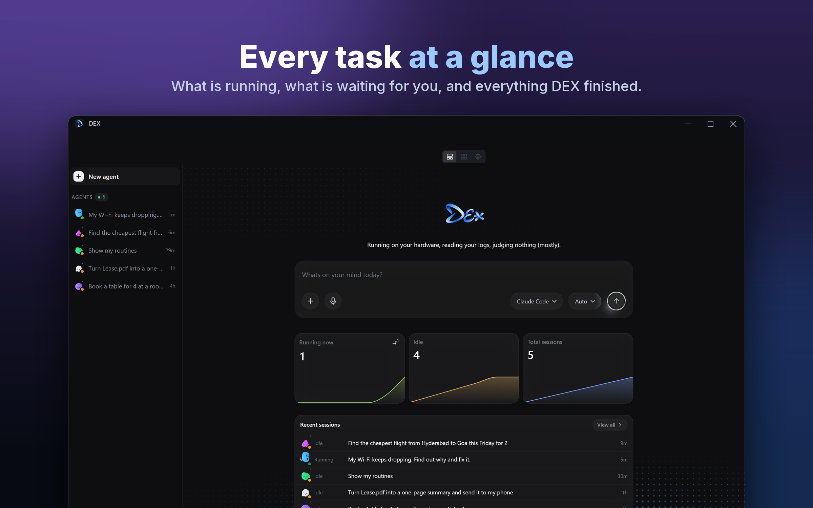
</p>

## Help build it

DEX is young and moving fast, and there's a lot of room to make your mark:

- **New connectors and travel/food sources** (restaurants, trains, buses).
- **macOS and Linux** ports — the agent core is cross-platform; the Windows
  control and installer aren't.
- **An iPhone app** to match the Android one.
- **Translations,** accessibility, and tests.

Start with an issue labelled
[good first issue](https://github.com/Chethan616/Dex/labels/good%20first%20issue)
or [help wanted](https://github.com/Chethan616/Dex/labels/help%20wanted), ask in
[Discussions](https://github.com/Chethan616/Dex/discussions), and read
[CONTRIBUTING.md](CONTRIBUTING.md). Found a bug? A clear
[issue](https://github.com/Chethan616/Dex/issues/new/choose) with steps and a
screenshot is one of the most useful things you can give.

If DEX saves you time, **a ⭐ helps more people find it.**

---

## Repository

```
desktop/app/          the Windows app (Electron + React + TypeScript)
  src/main/           main process: sessions, the shared browser (BrowserPool),
                      the agent's CDP broker, approvals, connectors, phone bridge
  src/renderer/hub/   the UI: dashboard, task workspace, chat, settings
  src/shared/         types and logic both sides use
  mcp-servers/        DEX's built-in MCP servers (Google, Microsoft, Reddit,
                      Blender, Windows)
  tests/              vitest unit tests
android/              the phone app (Kotlin, Jetpack Compose, Material 3 Expressive)
firebase/             Firestore rules and the setup script for your own project
docs/                 plans and research (docs/unify, docs/desktop-control)
TO_BE_DONE.md         the hand-over: state, rules, and what's next
```

## Building

**Desktop** (Windows, Node 22+, yarn):

```powershell
cd desktop\app
yarn install
yarn start          # dev build
npx vitest run      # tests
```

**Phone** (JDK 17+, Android SDK):

```powershell
cd android
.\gradlew :app:assembleDebug
```

Pairing the phone needs your own Firebase project: see `firebase/README.md`.
Release steps are in `TO_BE_DONE.md`.

## Contributing

Pull requests, issues and ideas are welcome — from a typo fix to a new
connector. [CONTRIBUTING.md](CONTRIBUTING.md) has the setup, the checks to run
and how reviews work. Be kind: [CODE_OF_CONDUCT.md](CODE_OF_CONDUCT.md).
Security issues go to [SECURITY.md](SECURITY.md), not a public issue.

## License

DEX is licensed under the **[Apache License 2.0](LICENSE)** — free to use,
change and ship, commercially too.

**Credit is required.** DEX was created by Chethan Krishna
([@Chethan616](https://github.com/Chethan616)). If you redistribute DEX or
build something from it, keep the attribution in [NOTICE](NOTICE) — in your
NOTICE file, docs or About screen — and mark the files you changed
(Apache-2.0 §4).

Third-party components and their licenses are in [LICENSES.md](LICENSES.md).
Code published before 7 October 2026 (before v1.0.0) was MIT.
